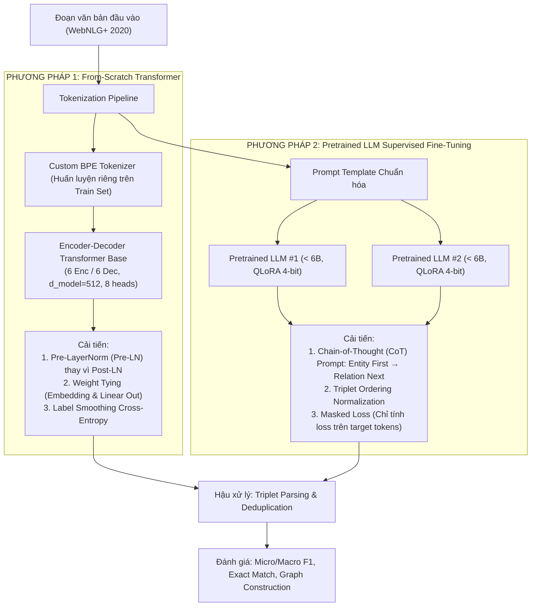
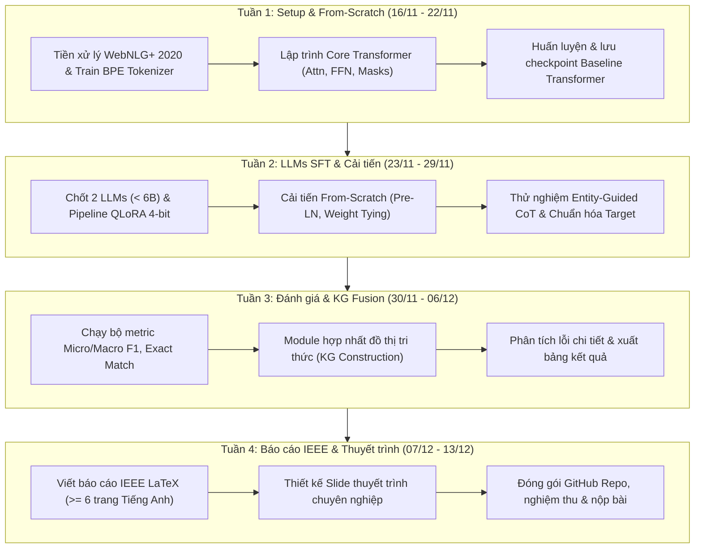

# BÁO CÁO ĐỀ TÀI BÀI TẬP LỚN NLP: XÂY DỰNG ĐỒ THỊ TRI THỨC (TEXT-TO-TRIPLES)

**Học phần:** Xử lý Ngôn ngữ Tự nhiên (Natural Language Processing)  
**Thời gian thực hiện:** 4 tuần (3 tuần phát triển kỹ thuật + 1 tuần viết báo cáo IEEE & chuẩn bị slide)  
**Tập dữ liệu:** WebNLG+ 2020 (`GEM/web_nlg`)  
**Chuẩn báo cáo đầu ra:** IEEE Conference Paper Format (Tiếng Anh, tối thiểu 6 trang)

---

## I. TỔNG QUAN ĐỀ TÀI & Ý TƯỞNG CỐT LÕI

### 1.1. Tên đề tài đề xuất
* **Tên tiếng Anh (dùng cho báo cáo IEEE):**  
  *“End-to-End Knowledge Graph Extraction from Unstructured Text: Comparative Study of From-Scratch Transformers and Parameter-Efficient Fine-Tuning of Small LLMs on WebNLG+”*
* **Tên tiếng Việt:**  
  *“Nghiên cứu so sánh giữa mô hình Transformer tự cài đặt và kỹ thuật Fine-tuning tham số hiệu quả trên các LLM cỡ nhỏ cho tác vụ trích xuất đồ thị tri thức từ văn bản”*

### 1.2. Mục tiêu kỹ thuật
1. **Pipeline Text-to-Triples:** Nhận vào một văn bản tiếng Anh mô tả thông tin thực tế → Trích xuất tập hợp các bộ ba `(Subject, Predicate, Object)` có cấu trúc.
2. **KG Fusion & Deduplication:** Hợp nhất các bộ ba từ nhiều câu/văn bản khác nhau, loại bỏ trùng lặp để dựng Đồ thị tri thức (Knowledge Graph - KG) hoàn chỉnh.
3. **So sánh 2 hướng tiếp cận đối nghịch:**
   * **Hướng 1 (From Scratch):** Tự lập trình 100% kiến trúc Transformer Encoder-Decoder theo Vaswani et al. (2017) bằng PyTorch cơ bản (không dùng `torch.nn.Transformer`).
   * **Hướng 2 (Pretrained LLMs):** Sử dụng **2 mô hình LLM hiện đại dưới 6 tỷ tham số (< 6B)** (hiện đang được thành viên phụ trách tự tìm hiểu, khảo sát và đánh giá để lựa chọn 2 mô hình phù hợp nhất, đảm bảo số tham số thực tế `< 6B` theo đúng yêu cầu đề bài), áp dụng QLoRA để huấn luyện có giám sát (SFT).

---

## II. ĐỊNH HƯỚNG KHẢO SÁT & LỰA CHỌN MÔ HÌNH PRETRAINED (< 6B PARAMS)

Đối với sinh viên năm 3 với tài nguyên phần cứng giới hạn (Google Colab T4 16GB VRAM, Kaggle P100/T4, hoặc GPU cá nhân như RTX 3060/4060), việc khảo sát kỹ các mô hình ở nhóm **dưới 6 tỷ tham số (< 6B)** (ví dụ phân khúc 3B – 5.xB) giúp tối ưu hiệu năng trích xuất quan hệ phức tạp trong khi vẫn tuân thủ đúng giới hạn đề bài và bộ nhớ GPU. Hiện tại, thành viên **Nguyễn Chí Phong** đang trực tiếp tìm hiểu và đánh giá để chốt **02 mô hình LLM (< 6B)** dựa trên bộ tiêu chí sau:

| Tiêu chí đánh giá | Yêu cầu đối với 2 mô hình LLM (< 6B) đang khảo sát |
| :--- | :--- |
| **Quy mô tham số (Bắt buộc)** | Phải **nhỏ hơn 6 tỷ tham số (< 6B)** theo đúng quy định của `BTL_Requirements.docx` (không chọn mô hình $\ge 6\text{B}$). |
| **Tài nguyên VRAM (QLoRA 4-bit)** | Khi lượng tử hóa 4-bit (NF4) kết hợp QLoRA và gradient checkpointing, VRAM huấn luyện phải nằm trong ngưỡng an toàn của GPU phổ thông (≤ 12–14 GB trên T4 16GB). |
| **Năng lực Structured Output** | Tuân thủ tốt instruction prompt, khả năng sinh chuẩn định dạng bộ ba `(Subject \| Predicate \| Object)` và hạn chế ảo giác (hallucination). |
| **Tính đối trọng so sánh** | Chọn **2 mô hình thuộc các họ/kiến trúc hoặc nhà phát triển khác nhau** để đảm bảo tính khách quan khi so sánh thực nghiệm trong báo cáo IEEE. |
| **Hệ sinh thái & Khả năng tái lập** | Trọng số công khai trên Hugging Face, hỗ trợ tốt với `transformers`, `peft`, `bitsandbytes` để dễ dàng chạy và tái lập kết quả. |

---

## III. THIẾT KẾ PHƯƠNG PHÁP & ĐỀ XUẤT CẢI TIẾN (ĐỂ ĐẠT ĐIỂM TỐI ĐA)




### 3.1. Phương pháp 1: Transformer Base From-Scratch
* **Cài đặt toán học cốt lõi:**
  1. *Scaled Dot-Product Attention:*
     $$\text{Attention}(Q, K, V) = \text{softmax}\left(\frac{Q K^T}{\sqrt{d_k}} + M\right)V$$
     với $M$ là ma trận Padding Mask hoặc Causal Mask.
  2. *Multi-Head Attention:* Ghép $h = 8$ heads độc lập, mỗi head có chiều $d_k = d_v = 64$.
  3. *Position-wise Feed-Forward Network (FFN):*
     $$\text{FFN}(x) = \max(0, x W_1 + b_1) W_2 + b_2$$
     với $d_{ff} = 2048$, $d_{model} = 512$.
  4. *Positional Encoding:* Sinusoidal Positional Encoding theo Vaswani et al. (2017).
* **Định dạng Target Linearization:**
  Biến đổi tập bộ ba thành chuỗi tuần tự có token đặc biệt:  
  `[BOS] (Alan Bean | mission | Apollo 12) <sep> (Apollo 12 | operator | NASA) [EOS]`
* **Đề xuất cải tiến (Bonus points):**
  * **Cải tiến 1: Pre-LayerNorm (Pre-LN):** Thay thế Post-LN của Transformer 2017 gốc bằng Pre-LN (chuẩn hóa trước Sub-layer):
    $$x_{l+1} = x_l + \text{Sublayer}(\text{LayerNorm}(x_l))$$
    Giúp gradient truyền ổn định hơn, không cần warmup quá dài và hội tụ nhanh hơn gấp đôi trên tập dữ liệu nhỏ.
  * **Cải tiến 2: Weight Tying:** Chia sẻ trọng số ma trận giữa Input Embedding của Decoder và ma trận Softmax Output Projection cuối cùng ($W_{embed} = W_{proj}^T$). Giúp giảm khoảng 15% – 20% số tham số cần học, tránh overfitting.
  * **Cải tiến 3: Label Smoothing (ε = 0.1):** Chống lại hiện tượng overconfident vào các từ phổ biến trong predicate.

---

### 3.2. Phương pháp 2: Supervised Fine-Tuning (SFT) 2 Pretrained LLMs
* **Chiến lược huấn luyện:**
  * Kỹ thuật **QLoRA (Quantized Low-Rank Adaptation)**: Load trọng số gốc ở 4-bit NF4, đóng băng (freeze) toàn bộ base model, gắn LoRA adapter vào các module `[q_proj, k_proj, v_proj, o_proj, gate_proj, up_proj, down_proj]`.
  * Cấu hình LoRA khuyến nghị: rank $r = 16$, $\alpha = 32$, dropout = 0.05.
* **Prompt Format chuyên nghiệp:**
  ```text
  <|im_start|>system
  You are an expert Information Extraction system. Your task is to extract all factual relational triples from the input text strictly in the format: (Subject | Predicate | Object). Do not hallucinate.<|im_end|>
  <|im_start|>user
  Text: "The 108th United States Congress began on January 3, 2003, and ended on January 3, 2005."<|im_end|>
  <|im_start|>assistant
  (108th United States Congress | startDate | 2003-01-03)
  (108th United States Congress | endDate | 2005-01-03)<|im_end|>
  ```
* **Loss Masking (Bắt buộc theo yêu cầu BTL):** Chỉ tính Cross-Entropy loss trên phần token của assistant (câu trả lời), che (mask label = -100) toàn bộ phần system và user prompt.
* **Đề xuất cải tiến (Bonus points):**
  * **Cải tiến 1: Triplet Sorting Normalization:** Sắp xếp các bộ ba trong ground truth theo thứ tự xuất hiện của Subject trong câu trước khi train. Tránh việc LLM bị bối rối bởi thứ tự ngẫu nhiên trong dữ liệu WebNLG.
  * **Cải tiến 2: Entity-First Chain-of-Thought (Two-stage prompting trong 1 bước):** Cho mô hình liệt kê các thực thể (Named Entities) nhận diện được trước, sau đó mới xuất các bộ ba quan hệ. Cải tiến này giúp tăng Micro F1 rõ rệt ở các văn bản phức tạp (≥ 3 bộ ba).

---

## IV. BỐ CỤC BÁO CÁO KỸ THUẬT (CHUẨN IEEE 6 TRANG TIẾNG ANH)

| Phần | Nội dung chi tiết cần viết | Số trang dự kiến |
| :--- | :--- | :--- |
| **I. Abstract** | Tóm tắt bài toán Text-to-Triples, giải pháp kết hợp From-Scratch Transformer và 2 LLMs (< 6B), các cải tiến chính và tóm tắt chỉ số Micro F1 đạt được. | 0.5 trang |
| **II. Introduction** | Động lực xây dựng KG tự động; thách thức khi trích xuất quan hệ phức tạp, chồng lấn; mục tiêu đóng góp của nhóm. | 0.75 trang |
| **III. Related Work** | Khảo sát các mốc: Pipeline RE/NER cổ điển → Sequence-to-Sequence (Seq2Seq) → Transformer Base (2017) → Kỷ nguyên Pre-trained LLM & PEFT (LoRA/QLoRA). | 0.75 trang |
| **IV. Methodology** | **4.1.** Toán học & Sơ đồ khối From-Scratch Transformer (Pre-LN, Multi-Head, Masking).<br>**4.2.** Kiến trúc 2 LLMs (< 6B) & cơ chế QLoRA.<br>**4.3.** Phân tích chi tiết các cải tiến (Weight Tying, Target Normalization, Entity-Guided Prompting). | 1.75 trang |
| **V. Experiments & Results** | **5.1.** Thống kê WebNLG+ 2020 & Thiết lập siêu tham số.<br>**5.2.** Bảng so sánh Micro/Macro Precision, Recall, F1, Exact Match giữa 3 mô hình (From-scratch vs LLM #1 (< 6B) vs LLM #2 (< 6B)).<br>**5.3.** Đồ thị Loss & Thảo luận định tính ví dụ thực tế. | 1.25 trang |
| **VI. Discussion & Error Analysis** | Phân tích sâu: Số bộ ba (1, 2, ≥ 3), hiện tượng Hallucination, lỗi cú pháp parse, so sánh ưu nhược điểm học từ đầu vs mô hình tiền huấn luyện. | 0.75 trang |
| **VII. Conclusion & Link Code** | Đúc kết kết luận, bài học kinh nghiệm, hạn chế và link GitHub chứa mã nguồn có thể tái lập (Reproducible code). | 0.25 trang |

---

## V. KẾ HOẠCH & TIẾN ĐỘ THỰC HIỆN CHI TIẾT (4 TUẦN)

### Phân bổ thời gian: 3 Tuần Kỹ thuật + 1 Tuần Báo cáo & Thuyết trình




| Tuần | Giai đoạn | Nhiệm vụ chính | Đầu ra cần đạt (Deliverables) |
| :---: | :--- | :--- | :--- |
| **Tuần 1**<br>*(16/11 - 22/11)* | **Setup & From-Scratch** | • Tải và tiền xử lý WebNLG+ 2020 (`GEM/web_nlg`).<br>• Huấn luyện BPE Tokenizer trên train set.<br>• Cài đặt Attention, Encoder, Decoder, Masks. | • Checkpoint Baseline Transformer.<br>• Log loss huấn luyện.<br>• Tokenizer artifact. |
| **Tuần 2**<br>*(23/11 - 29/11)* | **SFT 2 LLMs & Cải tiến** | • Chốt lựa chọn 02 mô hình LLM (< 6B) và xây dựng pipeline QLoRA 4-bit.<br>• Cài đặt cải tiến Pre-LN & Weight Tying.<br>• Thử nghiệm Entity-Guided CoT Prompting. | • Báo cáo ngắn tiêu chí chọn 2 LLMs (< 6B) & Adapters LoRA đã lưu.<br>• Checkpoint Transformer cải tiến.<br>• Bảng loss so sánh. |
| **Tuần 3**<br>*(30/11 - 06/12)* | **Đánh giá & KG Fusion** | • Đo Full-Triple Micro/Macro Precision, Recall, F1.<br>• Đánh giá theo số bộ ba (1, 2, ≥ 3) và domain.<br>• Hợp nhất bộ ba tạo KG (loại bỏ trùng lặp). | • Bảng số liệu thực nghiệm đầy đủ.<br>• Biểu đồ đồ thị tri thức (visual graph).<br>• Báo cáo Error Analysis. |
| **Tuần 4**<br>*(07/12 - 13/12)* | **Báo cáo & Thuyết trình** | • Viết hoàn thiện báo cáo IEEE 6 trang (English).<br>• Thiết kế Slide bảo vệ đề tài.<br>• Chuẩn hóa mã nguồn GitHub có thể tái lập (seed, script). | • File PDF báo cáo IEEE.<br>• File Slide PowerPoint (.pptx).<br>• Link GitHub public/private. |

---

* **Doãn Duy Lợi (24021549) - Lead: Data Pipeline & Training Strategy:** Tiền xử lý tập dữ liệu WebNLG+ 2020 (`GEM/web_nlg`), huấn luyện Custom BPE Tokenizer trên train split, viết vòng lặp huấn luyện (Training Loop với Teacher Forcing, Optimizer AdamW, lưu checkpoint tốt nhất theo validation), lập trình thuật toán giải mã tự hồi quy (Greedy Search & Beam Search), ghi nhận đầy đủ `max_length`, seed, thời gian chạy và cấu hình phần cứng cho nhánh Scratch, quản lý cấu trúc GitHub repo, viết Section I (Abstract), II (Introduction), III (Related Work) báo cáo IEEE và slide phần Giới thiệu/Dữ liệu.
* **Hoàng Lâm Tùng (24021661) - Lead: Transformer From-Scratch Core:** Lập trình các khối kiến trúc mạng cốt lõi bằng PyTorch thuần (Scaled Dot-Product, Multi-Head Attention, Pre-LayerNorm, Positional Encoding, Encoder/Decoder layers theo cấu hình baseline 6 enc/6 dec, $d_{model}=512$, 8 heads, $d_{ff}=2048$), tích hợp các cải tiến kiến trúc Pre-LN và Weight Tying, cài đặt Causal Mask & Padding Mask, thống kê số tham số, viết Section IV.A (Methodology Transformer Scratch) báo cáo IEEE và slide phần Kiến trúc Scratch.
* **Nguyễn Chí Phong (24020268) - Lead: Pretrained LLMs Fine-tuning:** Tự tìm hiểu, khảo sát và đánh giá để lựa chọn 02 mô hình LLM dưới 6 tỷ tham số (`< 6B`) phù hợp với bài toán và tài nguyên GPU; xây dựng pipeline SFT & QLoRA 4-bit cho 2 mô hình đã chọn, xử lý Target-only Loss Masking, tối ưu hóa siêu tham số LoRA, đo đạc chi phí tài nguyên phần cứng GPU (VRAM, training time, inference latency), viết Section IV.B & IV.C báo cáo IEEE và slide phần Fine-tuning LLM.
* **Bùi Thị Bích Phượng (24021601) - Lead: Evaluation & KG Fusion:** Xây dựng hệ thống tính toán chỉ số Full-Triple Micro/Macro Precision, Recall, F1 (loại trùng dự đoán trước khi tính), Exact-Set Accuracy và tỷ lệ đầu ra không parse được (unparseable rate); cài đặt bộ lọc chống ảo giác thực thể (Entity Hallucination Filter); lập trình module hợp nhất đồ thị tri thức (Knowledge Graph Fusion xuất file `.gexf`/`.json`), phân tích lỗi định tính (Error Analysis), viết Section V (Experiments), VI (Discussion & Error Analysis), VII (Conclusion) báo cáo IEEE và slide phần Đánh giá/Demo.

### Bảng Ma trận Phân công Trách nhiệm Chi tiết (RACI Matrix)

| Thành viên & MSSV | Vai trò chính | Nhiệm vụ kỹ thuật (Tuần 1 – Tuần 3) | Nhiệm vụ Báo cáo IEEE & Slide (Tuần 4) |
| :--- | :--- | :--- | :--- |
| **Doãn Duy Lợi**<br>*(24021549)* | ⭐ **Lead: Data Pipeline & Training Strategy** | - Tải, làm sạch và chuẩn hóa tập dữ liệu WebNLG+ 2020 (`GEM/web_nlg`).<br>- Huấn luyện Custom BPE Tokenizer (chỉ dùng trên train split).<br>- Viết vòng lặp huấn luyện (`train_scratch.py`): Teacher Forcing, Cross-Entropy Loss, Optimizer AdamW + Warmup Scheduler, lưu best validation checkpoint.<br>- Viết module sinh chuỗi tự hồi quy: Greedy Search và Beam Search ($B=4$).<br>- Triển khai chiến lược Curriculum Learning (1, 2, $\ge 3$ triples) và ghi nhận `max_length`, seed, thời gian chạy, cấu hình phần cứng Scratch. | - **Mục I (Abstract), II (Introduction), III (Related Work)**: Bối cảnh bài toán Knowledge Graph Construction và tổng quan nghiên cứu liên quan.<br>- Quản lý cấu trúc mã nguồn GitHub và tài liệu hướng dẫn (`README.md`).<br>- Thiết kế slide phần Giới thiệu bài toán & Dữ liệu. |
| **Hoàng Lâm Tùng**<br>*(24021661)* | ⭐ **Lead: Transformer Scratch Core** | - Lập trình các khối kiến trúc cốt lõi bằng PyTorch thuần (không dùng `nn.Transformer`): `ScaledDotProductAttention`, `MultiHeadAttention`, `PositionalEncoding`, `FeedForwardNetwork`, `PreLayerNorm`, `TransformerEncoder`/`Decoder` (baseline 6 enc/6 dec, $d_{model}=512$, 8 heads, $d_{ff}=2048$).<br>- Tích hợp cải tiến: **Pre-LayerNorm**, **Weight Tying**, **Label Smoothing**.<br>- Cài đặt mặt nạ: Padding Mask và Causal Mask; thống kê số lượng tham số mô hình. | - **Mục IV.A**: Trình bày chi tiết toán học, công thức tính Attention, cơ chế Pre-LN và Weight Tying.<br>- Vẽ sơ đồ khối kiến trúc mạng Transformer Pre-LN.<br>- Thiết kế slide phần Kiến trúc Transformer Scratch. |
| **Nguyễn Chí Phong**<br>*(24020268)* | ⭐ **Lead: Pretrained LLMs Fine-tuning** | - Tự tìm hiểu, khảo sát và đánh giá các ứng viên LLM **dưới 6 tỷ tham số (`< 6B`)** để chốt **02 mô hình** tối ưu nhất cho tác vụ Text-to-Triples và phần cứng GPU (tuyệt đối không chọn mô hình $\ge 6\text{B}$).<br>- Setup pipeline SFT & QLoRA 4-bit cho 02 mô hình LLM (`< 6B`) đã chọn.<br>- Tối ưu hóa siêu tham số LoRA ($r$, $\alpha$, learning rate, scheduler).<br>- Triển khai kỹ thuật Target-only Loss Masking.<br>- Đo lường chi phí phần cứng (Peak GPU VRAM, thời gian train, tốc độ suy luận). | - **Mục IV.B & IV.C**: Trình bày tổng quan 2 mô hình LLM (`< 6B`) đã chọn, tiêu chí & lý do lựa chọn, kỹ thuật QLoRA và Loss Masking.<br>- Bảng tổng kết siêu tham số và chi phí tài nguyên phần cứng.<br>- Thiết kế slide phần Pretrained LLMs. |
| **Bùi Thị Bích Phượng**<br>*(24021601)* | ⭐ **Lead: Evaluation & KG Fusion** | - Xây dựng bộ công cụ tính toán metric chuẩn: Full-triple Micro/Macro Precision, Recall, F1 (loại trùng dự đoán trên mỗi mẫu trước khi tính), Exact-Set Accuracy và **tỷ lệ đầu ra không parse được (unparseable rate)**.<br>- Xây dựng bộ parser chuyển đổi output sinh ra thành danh sách bộ ba $(s, p, o)$.<br>- Cài đặt **Entity Hallucination Filter** (loại bỏ bộ ba bịa đặt).<br>- Lập trình module hợp nhất đồ thị tri thức (**Knowledge Graph Fusion**) xuất file `.gexf` / `.json` trực quan hóa đồ thị.<br>- Thống kê phân tầng theo số lượng bộ ba (1, 2, $\ge 3$) và theo category/domain. | - **Mục V (Experiments & Results)**: Bảng kết quả tổng hợp so sánh 3 mô hình, biểu đồ Loss.<br>- **Mục VI (Discussion & Error Analysis)** và **Mục VII (Conclusion)**: Phân tích các trường hợp lỗi định tính.<br>- Thiết kế slide phần Thực nghiệm & Phân tích lỗi. |
